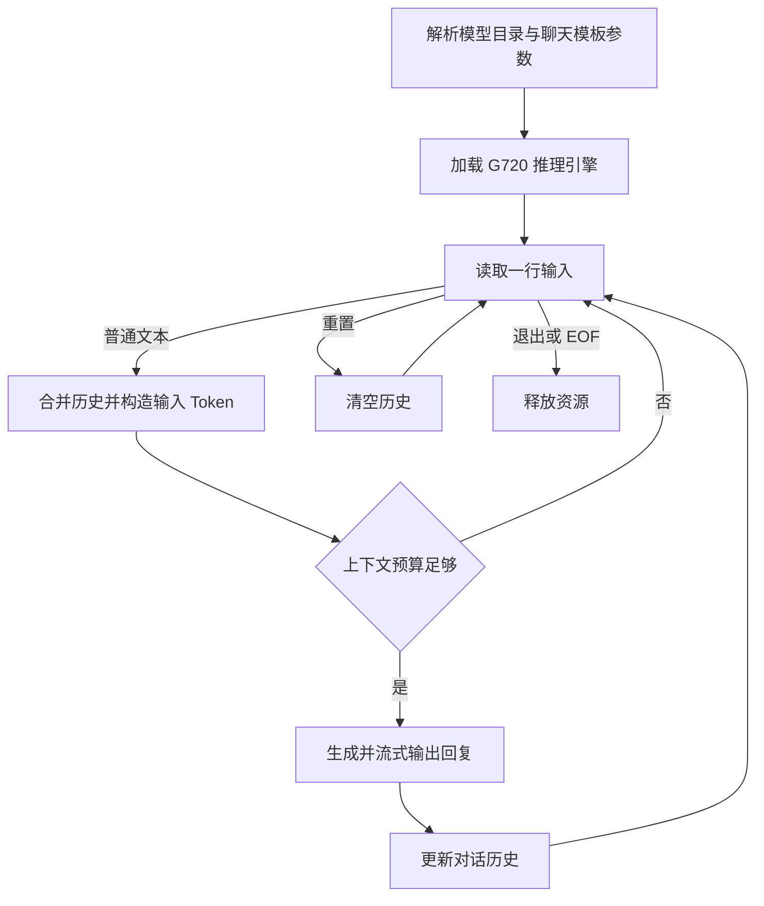

# MiniCPM5-2B C++ 连续对话

## 运行流程



模型包使用现有 [G720 MiniCPM5-2B 适配](../../mtk_models/gen_ai/llm/minicpm5_2b/README.md)。当前构建和板端状态见 [运行记录](results/summary.json)。

## 编译

CMake 自动读取本地 `config.json` 中的编译路径,首次使用按 [config.example.json](config.example.json) 填写一次.

在 Ubuntu Docker 中执行:

```bash
cd demo/MiniCPM5_2B
mkdir -p build
cd build
cmake ..
cmake --build .
```

产物为 `build/minicpm5_chat`.需要 CMake ≥ 3.19、C++17 和已准备的 AArch64 依赖.

## 板端运行

手动将程序和同版本官方 `chat_template.jinja` 放到板端同一目录,模型保持原位置.进入程序目录执行:

```bash
./minicpm5_chat --models /path/to/minicpm5_2b/models
```

| 参数 | 说明 |
| --- | --- |
| `--models` | 必填,已有模型资源目录 |
| `--chat-template` | 可选,默认当前目录的 `chat_template.jinja` |
| `--max-new-tokens` | 可选,每轮生成上限,默认 128 |
| `--help` | 查看用法 |

运行不需要配置文件或环境变量.`config.json` 只用于编译,不必复制到板端.

## 功能

- 多轮历史对话、中英文增量输出,模型只加载一次.
- `/reset` 清空历史;`/exit` 或 EOF 退出.
- 当前 W4A16 模型上下文为 1024 Token,输入与生成预算之和不能超过该上限.

本次改动未编译、未测试,由用户自行验证.
