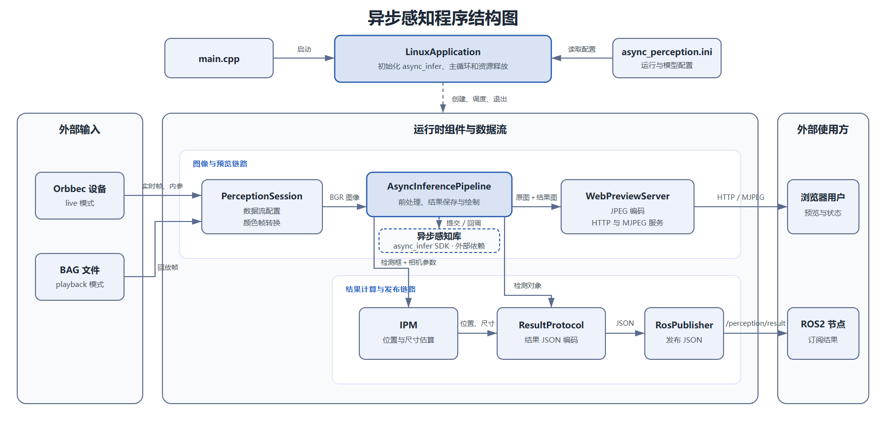
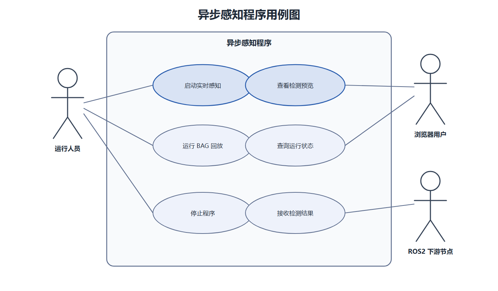

# 1. 文档目的

本文说明 `async_perception` 当前的代码结构和运行方式，重点描述各模块的职责、数据流、线程关系和外部接口。内容基于以下源码目录：

`/home/a/zhonghua.xue/shunyu-cleaning-robot-poc/40_robot_application/async_perception`

本文只记录现有实现，不讨论后续改造方案。

*注意，这是针对修改前的异步感知程序进行的设计文档报告。*

## 2. 系统概述

程序运行在 Linux 环境，支持两种图像来源：Orbbec 实时设备和 BAG 回放文件。彩色帧经过格式转换后送入 YOLO/OpenVINO 推理模块，检测结果用于画面绘制、物理位置估算、Web 预览和 ROS2 JSON 发布。

| 类型 | 当前实现 |
| --- | --- |
| 图像输入 | Orbbec 实时设备或 BAG 文件 |
| 感知处理 | 颜色转换、模型推理、检测框解析、结果绘制 |
| Web 输出 | 状态接口和 MJPEG 预览 |
| ROS2 输出 | `/perception/result`，消息类型为 `std_msgs/msg/String`，内容为 JSON |
| 配置 | `async_perception.ini`、模型路径和推理参数 |

## 3. 系统结构

下图展示当前程序的组成，以及图像和结果在组件之间的传递关系。

### 3.1 模块职责

| 模块 | 源码位置 | 职责 |
| --- | --- | --- |
| 程序入口 | `src/main.cpp` | 调用 Linux 平台入口函数。 |
| LinuxApplication | `src/platform/linux/linux_application.cpp` | 读取配置，初始化组件，执行逐帧处理并负责退出。 |
| WebPreviewServer | `src/platform/linux/web_preview_server.*` | 编码 JPEG，提供状态接口和 MJPEG 预览。 |
| RosPublisher | `src/platform/linux/ros2/ros2_json_publisher.*` | 初始化 ROS2，并发布结果 JSON。 |
| PerceptionSession | `src/shared/session/perception_session.hpp` | 配置 Orbbec 数据流，完成颜色帧转换。 |
| AsyncInferencePipeline | `src/shared/perception/async_inference_pipeline.hpp` | 提交推理任务，接收回调，保存检测结果并绘制。 |
| ResultProtocol | `src/shared/reporting/perception_result_protocol.hpp` | 把检测结果编码为 JSON。 |
| IPM | `src/geometry/ipm.hpp` | 根据相机参数估算地面位置和物理尺寸。 |

## 4. 运行流程

### 4.1 启动流程

1. `main()` 调用 `runLinuxApplication()`。
2. 程序读取 `async_perception.ini`，确定 `live` 或 `playback` 模式。
3. 启动 Web 预览服务和 ROS2 结果发布器。
4. 初始化异步推理 SDK，加载模型与推理配置。
5. 创建 Orbbec Pipeline。实时模式连接设备，回放模式打开 BAG 文件。
6. 读取相机内参并初始化 IPM；内参不可用时使用配置参数。

### 4.2 单帧处理流程

1. 等待 `FrameSet`，取得彩色帧和时间戳。
2. 把彩色帧转换为 RGB，再构造 BGR 格式的 OpenCV 图像。
3. 向 `AsyncInferencePipeline` 提交图像。
4. 主循环等待本帧推理回调完成。
5. 解析检测结果，在复制图像上绘制检测框和标签。
6. 将原图和结果图拼接后交给 `WebPreviewServer`。
7. 生成结果 JSON；需要时由 IPM 补充位置和尺寸信息。
8. 通过 `/perception/result` 发布 JSON，然后处理下一帧。

### 4.3 退出流程

收到停止信号或数据结束后，程序退出主循环，依次停止相机、Web 服务、推理模块和 ROS2 运行时。

## 5. 线程与并发关系

| 执行单元 | 工作内容 | 数据交接 |
| --- | --- | --- |
| 应用主线程 | 采集、颜色转换、提交推理、等待结果和发布 | 把预览帧交给 Web 服务，把检测结果交给协议编码器 |
| 推理回调线程 | 接收 SDK 推理结果并通知等待方 | 写入本帧检测结果 |
| JPEG 编码线程 | 编码最新待处理画面 | 更新最新 JPEG 数据 |
| HTTP 服务线程 | 处理页面、状态和 MJPEG 请求 | 读取最新 JPEG 数据 |

程序使用异步推理接口，但应用主线程提交一帧后会立即等待该帧回调。因此当前只有一帧在途，没有形成多帧并行流水线。

## 6. 外部接口

### 6.1 Web 接口

| 路径 | 用途 |
| --- | --- |
| `/` | 预览页面 |
| `/api/status` | 服务状态和最新帧信息 |
| `/stream.mjpg` | MJPEG 视频流 |

Web 预览采用“只保留最新帧”的方式。主线程提交新画面后，JPEG 编码线程更新最新结果，HTTP 服务线程把最新 JPEG 发给浏览器。

### 6.2 ROS2 输出

检测结果通过 `/perception/result` 发布，消息类型为 `std_msgs/msg/String`。字符串内容为 JSON，包含帧信息、检测对象、类别编号、置信度、图像坐标框、物理位置和诊断数据。

### 6.3 类别名称

应用层目前使用 `class-N`、`clsN` 一类通用名称，没有接入正式的业务类别映射。因此模型输出类别编号为 `0` 时，界面和 JSON 只能显示 `class 0` 或等价名称。

## 7. 用例

下图展示运行人员、浏览器用户和 ROS2 下游节点可以使用的能力。

| 编号 | 参与者 | 用例 | 结果 |
| --- | --- | --- | --- |
| UC-01 | 运行人员 | 启动实时感知 | 程序连接 Orbbec 设备并持续处理图像。 |
| UC-02 | 运行人员 | 运行 BAG 回放 | 程序读取回放文件并执行感知处理。 |
| UC-03 | 浏览器用户 | 查看检测预览 | 浏览器显示原图和检测结果图。 |
| UC-04 | 浏览器用户 | 查询运行状态 | 浏览器取得服务状态和最新帧信息。 |
| UC-05 | ROS2 下游节点 | 接收检测结果 | 订阅者取得 JSON 检测数据。 |
| UC-06 | 运行人员 | 停止程序 | 程序退出循环并释放各组件资源。 |

## 8. 当前实现特点

- 推理 SDK 提供异步接口，但应用层按“提交一帧、等待一帧”的方式运行。
- Web 预览只保留最新待编码帧和最新 JPEG，避免预览请求阻塞感知主循环。
- 实时模式启用了深度流，但当前检测和结果绘制只使用彩色图像。
- 类别编号和业务类别名称之间没有正式映射。
