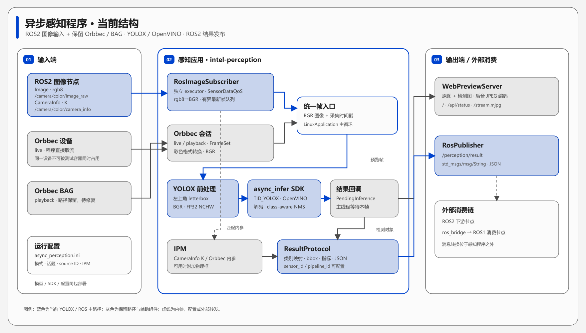
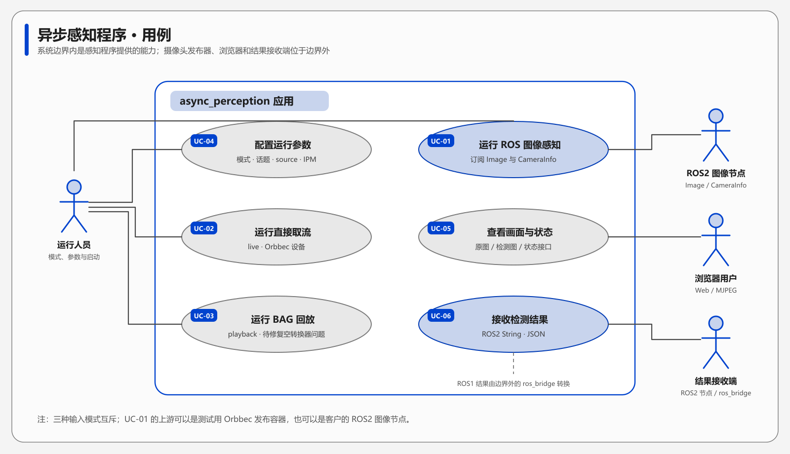

# 异步感知程序设计文档（YOLOX + ROS2 图像输入）

## 1. 文档目的

本文说明引入 YOLOX 前后处理和 ROS2 图像输入后的程序结构、数据流、线程关系、对外接口与运行边界。涉及两个代码范围：主工程 `async_perception`，以及作为依赖交付的 `async_infer_sdk`。文中所述“当前实现”以源码和配置为准；

## 2. 系统概述

程序在 Linux x86_64 环境运行，使用 Intel OpenVINO 异步推理 SDK 执行 YOLOX 检测。输入模式由 `src/platform/linux/config/async_perception.ini` 的 `application.mode` 指定：`ros` 订阅 ROS2 原始图像，`live` 直接读取 Orbbec 设备，`playback` 打开 Orbbec BAG。`ros` 和 `live` 已能汇入同一条 BGR 图像、YOLOX 推理、结果编码、Web 预览和 ROS2 结果发布链路；`playback` 当前有 4.2 节所述的取帧缺口。

| 项目         | 当前实现                                                     |
| ------------ | ------------------------------------------------------------ |
| 默认输入     | `ros`：`/camera/color/image_raw`，`sensor_msgs/msg/Image`，仅接受 `rgb8` |
| 相机内参     | `/camera/color/camera_info`，`sensor_msgs/msg/CameraInfo`；ROS 模式使用 `K` 中的 `fx/fy/cx/cy` |
| 保留输入分支 | `live`：Orbbec 设备；`playback`：Orbbec BAG                  |
| 推理模型     | YOLOX，`640×640`，由异步推理 SDK 加载 OpenVINO XML/BIN       |
| 结果输出     | `/perception/result`，`std_msgs/msg/String`，消息内容为 JSON |
| 辅助输出     | HTTP 状态接口、MJPEG 原图/检测图预览；可选控制台 JSON 行     |
| ROS1 下游    | 外部 `ros_bridge` 容器转换 ROS2 结果；                       |

## 3. 系统结构

图 1 说明“图像、模型和结果分别经过哪些组件”。实线表示主要数据流；虚线表示配置、相机内参或外部转发关系。Orbbec 测试发布容器只是 ROS 输入的一种上游实现，交付时可以换为符合接口约定的客户节点。

*图 1　异步感知程序当前结构。*

### 3.1 组件职责

| 组件                 | 源码位置                                                     | 职责                                                         |
| -------------------- | ------------------------------------------------------------ | ------------------------------------------------------------ |
| 程序入口             | `src/main.cpp`                                               | 调用 `runLinuxApplication()`。                               |
| `LinuxApplication`   | `src/platform/linux/linux_application.cpp`                   | 解析 INI、选择输入模式、初始化组件、执行逐帧主循环并负责退出。 |
| `RosImageSubscriber` | `src/platform/linux/ros2/ros2_image_subscriber.*`            | 独立 executor 接收 Image/CameraInfo；校验 `rgb8` 图像并转换成 BGR；维护有界最新帧队列。 |
| Orbbec 会话辅助函数  | `src/shared/session/perception_session.hpp`                  | 为 `live`/`playback` 配置数据流并将彩色帧转换为 RGB。        |
| YOLOX 应用层推理     | `src/shared/perception/async_inference_pipeline.hpp`         | 左上角 letterbox、组装 NCHW 输入、异步提交/等待回调、类别名称映射与绘制。 |
| YOLOX SDK 模块       | `dep/linux-x86_64/async_infer_sdk/sdk/lib/libasync_infer.so`；对应 `async_infer_lib` 仓库的 `infer_module_yolox.*` | OpenVINO 推理、YOLOX 输出解码、置信度过滤和 class-aware NMS。YOLOv11/原 YOLO 模块仍在 SDK 中，未被 YOLOX 覆盖。 |
| `IpmCalculator`      | `src/geometry/ipm.hpp`                                       | 使用相机内参及安装姿态估算检测框物理尺寸。                   |
| 结果协议             | `src/shared/reporting/perception_result_protocol.hpp`        | 将检测结果编码为 JSON，写入类别名称、时间戳、诊断指标和可用的 `physical_bbox`。 |
| `RosPublisher`       | `src/platform/linux/ros2/ros2_json_publisher.*`              | 发布 `/perception/result`。                                  |
| `WebPreviewServer`   | `src/platform/linux/web_preview_server.*`                    | 后台 JPEG 编码、HTTP 状态接口和 MJPEG 预览。                 |
| 测试图像发布器       | `tools/orbbec_ros2_publisher/`                               | 在独立 Docker 容器读取 Orbbec 彩色流，发布测试用 Image 和 CameraInfo。 |

### 3.2 部署边界

`intel-perception` 容器运行感知程序及模型/SDK/配置；`orbbec-image-publisher` 容器在测试阶段独占 Orbbec 摄像头并发布 ROS2 图像。`ros_bridge` 和 `ros1_noetic` 是结果转换与接收验证容器。感知程序不负责启动或管理这些外部容器。`live` 模式直接占用 Orbbec 摄像头，不能与测试发布容器同时使用同一设备。

## 4. 输入与单帧处理

### 4.1 ROS2 输入模式

1. `RosImageSubscriber` 以 `SensorDataQoS` 订阅图像和内参；订阅回调在独立的 `SingleThreadedExecutor` 线程中运行。
2. 图像回调仅接受 `rgb8`，检查宽高、步长和数据长度，按消息的 `step` 读取，再用 OpenCV 转为 BGR。其他编码被跳过，不会自动按 `bgr8` 或压缩图像解释。
3. `header.stamp` 被程序转为毫秒并写入结果的 `capture_timestamp_ms`。图像放入容量为 `1–8` 的有界队列，默认容量为 `2`；队列满时丢弃最旧帧。测试发布器在构造消息时用 `node->now()` 填写该字段，并未转发摄像头的硬件采集时间戳。
4. 主循环每次取队列中的最新帧并清空旧帧，优先保证结果新鲜度，不保证逐帧处理。
5. CameraInfo 只在宽高与图像一致、`frame_id` 不冲突、`K` 中焦距有效时用于 IPM。相机安装高度和姿态仍来自 INI。没有匹配内参时照常推理和发布检测结果，但不写入 `physical_bbox`。

当前 CameraInfo 处理使用最近一次有效内参，不按时间戳与图像逐帧精确同步；程序也不执行图像去畸变。测试发布器的 CameraInfo 未填充畸变模型，不能把 `physical_bbox` 当作完成几何标定后的高精度测量值。

### 4.2 `live` 与 `playback` 模式

`live` 选择 Orbbec 设备并启动彩色/可用的深度流，`playback` 分支打开 BAG。当前检测只使用彩色图像；深度帧不直接参与 YOLOX 或结果协议。Orbbec 内参优先用于 IPM，读取失败时可使用 INI 中的手动内参。

**注意**当前源码存在一处明确的 `playback` 路径缺口：`linux_application.cpp` 在 `playback` 模式不创建 `FormatConvertFilter`，但主循环仍调用 `ensureRgbFrame(colorFrame, converter)`；该函数在 `converter == nullptr` 时直接返回空帧。因此，现有代码即使从 BAG 取得彩色帧，也会在推理前跳过该帧。`playback` 是保留的入口和待修复用例，不能将其视为已通过运行验证的功能。

### 4.3 共用推理与输出链路

1. 输入 BGR 图像按比例缩放到 `640×640` 内，贴在左上角，空白处以 `114` 填充。数据保持 BGR 通道顺序和 `0–255` 数值范围，组装为 FP32 NCHW；没有除以 `255` 的归一化。
2. 应用提交 `TID_YOLOX` 任务，并保存输入缓冲区直至 SDK 回调完成。SDK 加载 OpenVINO 模型并执行 YOLOX 后处理。
3. SDK 对每个候选只取分数最高的一个类别，置信度为 `sigmoid(objectness) × sigmoid(best_class_logit)`；按类别执行 NMS，不跨类别互相抑制。边框按 letterbox 比例映射回原图。
4. 主循环等待本帧回调，取得检测对象后绘制叠加图；Web 服务后台编码“原图 + 结果图”的并排预览。
5. 结果协议将检测对象编码为 JSON，必要时由 IPM 附加 `physical_bbox`，再发布 ROS2 消息。

SDK 虽提供异步任务接口，但当前应用主循环是“提交一帧、等待该帧回调、再处理下一帧”；没有多帧同时在途的应用层流水线。`waitInference()` 的等待超时为 30 秒。

## 5. YOLOX 模型与类别定义

主工程按 `TID_YOLOX` 调用 SDK，YOLOX 模块作为新增模块保留在 `async_infer_lib` 中；旧 YOLO 模块未被替换。打包时，CMake 将 SDK 的 `yolox_root_config.json` 复制为运行包的 `config/0_root_config.json`，同时复制 `yolox_config.json` 和模型目录。因此，运行包内的可执行文件、SDK 动态库、配置、XML/BIN 应作为同一版本核对。

当前 `yolox_config.json` 的关键值如下；修改运行包参数应核对实际部署的配置，而不是只改源码目录副本。

| 参数                                              | 当前值                         | 作用                          |
| ------------------------------------------------- | ------------------------------ | ----------------------------- |
| `model_path`                                      | `../models/yolo/yolo_int8.xml` | OpenVINO XML；BIN 与 XML 配套 |
| `device`                                          | `NPU`                          | OpenVINO 执行设备             |
| `input_width` / `input_height` / `input_channels` | `640 / 640 / 3`                | 模型输入维度                  |
| `conf_th`                                         | `0.7`                          | 候选置信度门限                |
| `iou_th`                                          | `0.45`                         | NMS 的 IoU 门限               |
| `pre_nms_top_k` / `nms_top_k`                     | `3000 / 300`                   | NMS 前候选数和最终保留数上限  |

类别名称在应用层 `garbageClassName()` 中定义，Web 标注和 JSON 的 `category_code` 共用这套映射：

| 类别编号 | `category_code` |
| -------- | --------------- |
| 0        | `liquid`        |
| 1        | `debris`        |
| 2        | `paper`         |
| 3        | `cable`         |
| 4        | `bottle`        |

未知编号回退为 `class-N`。类别编号与模型训练时的输出顺序必须一致；名称映射不会改变模型预测。

## 6. 线程与数据交接

| 执行单元               | 工作                                                         | 交接方式                                                     |
| ---------------------- | ------------------------------------------------------------ | ------------------------------------------------------------ |
| 应用主线程             | 取最新帧、YOLOX 预处理与提交、等待回调、绘制、JSON 编码/发布 | 每次只等待当前 `PendingInference`；ROS 图像输入从有界队列读取 |
| ROS 图像 executor 线程 | 接收 Image 和 CameraInfo                                     | 图像队列、最新有效内参，受互斥锁保护                         |
| SDK 推理与回调线程     | OpenVINO 执行和结果回调                                      | 写入 `PendingInference` 并唤醒主线程                         |
| Web JPEG 编码线程      | 编码最新预览帧                                               | 覆盖待处理画面、更新最新 JPEG                                |
| Web HTTP 服务线程      | 提供页面、状态和 MJPEG                                       | 读取最新 JPEG，不阻塞主推理循环                              |

ROS 图像队列和 Web 预览都优先保留最新内容。这能限制积压，但不能单独保证端到端延迟上界；原始 `1280×720 rgb8` 图像约 2.76 MB/帧，跨容器传输、编码和推理耗时仍需按交付环境测量。

## 7. 外部接口与配置

| 方向 | 接口                               | 类型 / 说明                                                  |
| ---- | ---------------------------------- | ------------------------------------------------------------ |
| 输入 | `/camera/color/image_raw`          | `sensor_msgs/msg/Image`；`rgb8`，`header.stamp` 被感知端作为采集时间使用 |
| 输入 | `/camera/color/camera_info`        | `sensor_msgs/msg/CameraInfo`；宽高、`frame_id`、`K` 与图像对应 |
| 输出 | `/perception/result`               | `std_msgs/msg/String`，字符串是 JSON                         |
| Web  | `/`、`/api/status`、`/stream.mjpg` | 页面、运行状态、MJPEG 画面；默认端口 `8080`                  |

JSON 包含 `sequence_id`、发送时 `timestamp_ms`、`source`、`frame`、`perception.objects` 和 `diagnostics`。`frame.capture_timestamp_ms` 来自输入图像时间戳；`frame.format` 当前固定写为 `RGB`，不表示内部 OpenCV 缓冲区的通道顺序。每个对象含类别、置信度和像素坐标框；仅在 IPM 有效且物理框计算成功时包含 `physical_bbox`。

| INI 配置项                                      | 当前默认值                                              | 说明                                         |
| ----------------------------------------------- | ------------------------------------------------------- | -------------------------------------------- |
| `application.mode`                              | `ros`                                                   | `ros`、`live`、`playback` 三选一             |
| `ros.image_topic` / `ros.camera_info_topic`     | `/camera/color/image_raw` / `/camera/color/camera_info` | ROS2 输入话题                                |
| `ros.queue_capacity`                            | `2`                                                     | 图像缓存容量，允许 `1–8`                     |
| `reporting.sensor_id` / `reporting.pipeline_id` | `orbbec_rgbd` / `rgbd_async_v1`                         | JSON `source` 标识，可配置；默认值保持旧协议 |
| `web_preview.enabled` / `web_preview.port`      | `true` / `8080`                                         | Web 预览开关与端口                           |
| `ipm.*`                                         | 见 INI                                                  | 安装高度、姿态及 Orbbec 模式的手动内参回退   |

ROS 模式下，如果未显式设置 `FASTDDS_BUILTIN_TRANSPORTS`，程序会将其设为 `UDPv4`；测试发布容器也设置为 `UDPv4`。这是当前独立容器 IPC 环境下的传输配置。测试发布器使用 host 网络、USB 设备映射和 `ROS_DOMAIN_ID=0`；客户上游节点仍需核对话题、编码、QoS、时间戳、`frame_id` 与通信环境。

## 8. 用例

图 2 回答“谁从程序获得什么能力”。图中的 ROS1 结果接收是经外部 bridge 转换完成，不表示本程序直接发布 ROS1 消息。

*图 2　异步感知程序用例及外部参与者。*

| 编号  | 参与者                      | 用例              | 结果                                                         |
| ----- | --------------------------- | ----------------- | ------------------------------------------------------------ |
| UC-01 | 运行人员、ROS2 图像发布节点 | 运行 ROS 图像感知 | 程序订阅 Image/CameraInfo 并处理最新彩色帧。                 |
| UC-02 | 运行人员、Orbbec 摄像头     | 运行直接取流      | 程序在 `live` 模式从设备获取彩色帧。                         |
| UC-03 | 运行人员、BAG 文件          | 运行回放          | 目标是处理记录的帧；当前空转换器问题导致彩色帧在推理前被跳过。 |
| UC-04 | 运行人员                    | 配置运行参数      | 选择模式、输入话题、结果标识、预览和 IPM 参数。              |
| UC-05 | 浏览器用户                  | 查看画面与状态    | 取得原图/叠加图以及 Web 状态信息。                           |
| UC-06 | ROS2 下游节点、`ros_bridge` | 接收检测结果      | 订阅 JSON 结果；bridge 可继续转为 ROS1。                     |

## 9. 主要源码与交付文件

| 内容                      | 相对主工程根目录的路径                                       |
| ------------------------- | ------------------------------------------------------------ |
| 主循环与三种输入模式      | `src/platform/linux/linux_application.cpp`                   |
| ROS2 图像与内参订阅       | `src/platform/linux/ros2/ros2_image_subscriber.hpp`、`.cpp`  |
| YOLOX 应用层预处理与绘制  | `src/shared/perception/async_inference_pipeline.hpp`         |
| JSON 协议和类别名称       | `src/shared/reporting/perception_result_protocol.hpp`、`src/shared/perception/async_inference_pipeline.hpp` |
| 运行配置                  | `src/platform/linux/config/async_perception.ini`             |
| 测试图像发布容器          | `tools/orbbec_ros2_publisher/`                               |
| SDK、模型和配置的打包规则 | `CMakeLists.txt`                                             |