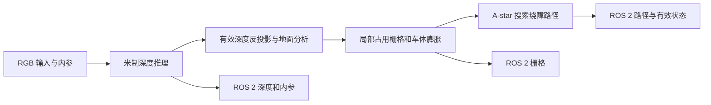

# RGB 单目深度、绕障路径与 ROS 2 输出 Demo 开发计划

状态: **计划阶段,未实现、未编译、未进行板端验证**.本轮只编写开发文档,代码实现待计划确认后开始.

## 计划流程



先用固定输入检查深度单位、坐标关系和栅格状态，再接相机和 RViz2。图中的模块和接口为设计目标。

## 在小车工程中的位置

本目录是小车应用的独立视觉与局部规划子 Demo,公共构建、依赖和平台切换遵循 [Demo 总体工程计划](../README.md).当前以固定前方目标完成绕障路径展示,后续由 `robot_demo` 提供目标并复用同一核心实现.

固定目标属于演示入口,不是写死在 A-star 内的业务规则.核心规划接收显式目标,ROS 2 适配层预留目标与取消的接入位置;整体任务接口在集成阶段确定.当前仍不连接底盘,不实现轨迹跟踪.

## 目标与最小范围

使用一个固定安装的 RGB 摄像头,在 Genio 720 / MT8189 上运行 C++ 工程,完成以下链路:

```text
RGB 摄像头
    ↓
Depth Anything V2 Metric Indoor Small
    ↓
米制预测深度 + 相机标定
    ↓
地面分析与几何障碍物提取
    ↓
局部 2D occupancy grid + 障碍物膨胀
    ↓
前方目标点 + A-star 路径搜索
    ↓
ROS 2 发布深度 / 栅格 / 绕障路径 → RViz2 可视化
```

首版 **通过 ROS 2 输出感知与规划结果,完成路径可视化,不连接底盘**.ROS 2 输出是正式交付接口,不能只在本地窗口画线.展示场景为室内平整地面: 起点与目标点沿前方直线排列;无障碍时输出直线,摆放一个障碍物后输出绕开障碍物、回到前方目标点的路径.

只使用一个深度模型,不加入 PIDNet-S 或其他分割、检测模型.引入 ROS 2 消息发布与 RViz2 展示,首版不引入完整 Nav2、SLAM、视觉里程计、多帧建图、运动控制或路径跟踪.每帧重新生成参考车体坐标系下的局部路径,不宣称小车已经实际行驶或完成物理绕障.深度和路径只要求能支持受控场景演示,不预先承诺测距误差或实时帧率.

## 输入、输出与演示条件

输入为单路 RGB 摄像头图像.首版优先使用 Linux 可接入的 USB/UVC 摄像头,实际设备类型在开发时核对;若现场使用 MIPI,只替换采集适配器.摄像头须固定高度和俯仰角,视野同时覆盖地面、障碍物及至少一侧绕行空间.

必须准备相机内参、畸变参数、相机相对参考车体的位置和姿态.首版不连接真实底盘,仍使用虚拟车体尺寸计算通行宽度.没有有效标定时明确提示配置缺失,不使用任意焦距生成看似有效的米制地图.

初始场景选择一个明显高于地面的纸箱或类似实体障碍物,位于相机可见范围内,旁边留出充分空间.暂不以玻璃、镜面、细线、坑洞、楼梯、复杂坡道或动态人员作为首版验收场景.

默认通过 ROS 2 在 RViz2 展示下列结果;本地组合画面只作为可选展示,不作为唯一输出:

- RGB 原图和障碍物距离标注.
- 深度伪彩图与固定米制色标.规划始终使用原始浮点米制深度,不使用伪彩或逐帧归一化图计算距离.
- 俯视局部栅格: 空闲、占用、未知、膨胀禁行区.
- 起点、前方目标点、原始直线和实际规划路径;无路时明确显示“无可用路径”.

## 模型资源与当前基础

指定模型为 **Depth Anything V2 Metric Hypersim Small**,即官方室内米制 Small 版本.官方说明该版本输出米制深度,室内使用 `max_depth=20`;这个模型参数不代表 20 米内均满足测距要求.[官方模型卡](https://huggingface.co/depth-anything/Depth-Anything-V2-Metric-Hypersim-Small)、[官方 Metric Depth 说明](https://github.com/DepthAnything/Depth-Anything-V2/blob/main/metric_depth/README.md).

实际资源来源:

- 源码: [DepthAnything/Depth-Anything-V2](https://github.com/DepthAnything/Depth-Anything-V2),使用 `metric_depth/` 实现.
- 权重: [`depth_anything_v2_metric_hypersim_vits.pth`](https://huggingface.co/depth-anything/Depth-Anything-V2-Metric-Hypersim-Small/resolve/main/depth_anything_v2_metric_hypersim_vits.pth).
- 模型卡标注许可为 Apache-2.0;实施时固定源码与权重版本,保留实际来源、文件名及许可记录,本轮不下载资源.

仓库现有 [depth_anything_v2_small](../../../mtk_models/navigation/single_camera_depth/depth_anything_v2_small/README.md) 是**相对深度**实现.[S100 米制深度适配](../../../rdk_models/navigation/single_camera_depth/depth_anything_v2_metric_hypersim_vits/README.md)可供核对模型结构、权重和输出语义.目标设备使用该目标实际编译的制品,分别记录精度和性能.

实施前先核对是否已有来源明确且契约匹配的 Metric 编译包.若没有,将该型号作为独立模型适配,按仓库规范安排浮点参考、转换、量化和 NPU 编译.量化精度、输入大小、原生 dtype 和量化尺度以实际转换结果确定,不因为已有相对深度模型是 INT8 就预先照搬.

模型资源与编译流程由对应平台的模型适配目录维护.Demo 使用原生 C++ 接入目标 Runtime,按模型包的实际输入输出和坐标单位处理结果.

## 几何处理与障碍物距离

1. 采集图像并校正畸变,或确保使用与当前图像对应的有效相机模型.模型输入缩放、颜色顺序、归一化及输出还原严格对齐所选官方实现.
2. 将预测深度还原到同一幅校正图像的像素坐标.不同分辨率的深度和相机内参必须匹配,不能直接用模型输入像素配原图内参.
3. 明确所用模型及参考实现的深度语义.按相机光轴深度 Z 反投影时使用 `X=(u-cx)*Z/fx`、`Y=(v-cy)*Z/fy`、`Z=depth`;通过已知平面和距离核对几何结果.不得把光轴深度直接当作沿视线的欧氏距离.
4. 相机坐标采用右、下、前,参考车体坐标采用前、左、上.用已标定的刚体变换把三维点转换到参考车体坐标,坐标方向、变换方向及单位明确写入配置.
5. 首版以已知安装高度和姿态建立地面参考.在近处地面 ROI 中用受约束的平面拟合修正小偏差,限制法向与高度变化;拟合失败或有效点不足时显示不可规划,不让墙面或箱顶替代地面.
6. 根据相对地面的高度提取几何障碍物,筛除远处、无效、非有限和饱和深度.障碍物高度门槛、车体高度和有效距离均由配置给出.不自动将模型输出称为具有置信度的测量值,有效性规则只是工程筛选.
7. 对障碍点做简单空间聚合,输出区域与距离,无需识别物体名称.距离标注使用参考车体坐标下的水平距离,同时保留前向距离;用足够支持点的近端稳健统计值抑制孤立噪点,不把单个最小深度像素作为整个障碍物距离.

距离是从参考原点计算的估计值,若要显示到车头的距离,须结合车体边界另行换算.首版通过现场已知距离检查量级与稳定性,不对单目预测作高精度承诺.

## 局部栅格与可通行区域

首版只生成单帧局部地图,栅格定义在参考车体坐标系,使用米为单位的原点、分辨率和范围.可先以 **前方约 3 m、左右各约 1.5 m、分辨率约 0.1 m** 作为配置起点,这些数值不是固定验收指标,实际范围必须限制在相机确实观测到的地面区域内.

每格保留明确状态:

| 状态 | 判定依据 | 规划处理 |
| --- | --- | --- |
| 未知 | 初始状态;未观测、遮挡、视野外、无效深度或地面证据不足 | 默认不可通行 |
| 空闲 | 有足够有效地面支持,且无障碍证据 | 可作为候选区域 |
| 占用 | 有足够高度与空间支持的障碍点 | 不可通行,优先于地面证据 |

不把“没有障碍点”当作空闲.不沿相机三维射线的俯视投影直接清空地面格子,因为射线可能从低矮障碍物上方经过.不通过大范围填洞把遮挡区域补成可走地面.

在占用栅格基础上,使用虚拟车体外接圆半径与额外余量做障碍物膨胀,简化为圆形小车路径规划.未知区域和地图边界也必须满足相同的车体足迹约束,不能只检查路径中心是否位于空闲格.车长、车宽及余量配置化,首版不处理阿克曼转弯半径.

有效空闲区域必须与起点相连.相机近处盲区中的起点不能自动设为空闲: 优先调整安装使近处可见;若演示需要人工确认的一小块起始空闲区,明确配置、限制范围并在画面中区分,不把它算作视觉观测结果.

## 最简单的绕障路径规划

不做完整导航系统,只在当前局部栅格内规划几何折线路径:

1. 起点设在已确认空闲的参考车体附近位置;目标点设在同一直线前方,例如车体 X 轴约 2.5 m 处,实际值由可见范围确定.
2. 先检查起终点、连通性及车体足迹是否有效.目标落入占用、未知或视野外时直接报告原因,不偷偷移动目标点伪造成功.
3. 若起点到目标点的整条直线在膨胀地图中可通行,直接输出两点直线路径.
4. 直线受阻时,用 8 邻域 A-star 搜索绕行路径,按移动长度计代价,使用一致的启发式;禁止斜向穿越障碍物角点.
5. 将连续可直达的节点合并,每一段都进行栅格覆盖与碰撞检查.首版不加曲线优化,避免平滑后切入障碍物.
6. 显示从原直线向侧面绕行、再回到前方目标点的折线.相机看不到障碍物后方地面,且无法找到连续已知空闲绕行通道时,显示无路,不假设障碍物后方为空闲.

每次规划绑定当前帧编号和时间.新帧不可规划时清除旧路径或明确显示失效,不继续展示旧路径作为当前结果.可以降低规划刷新率,但必须显示结果时间,不能混用不同帧的深度、栅格和路径.

这里的路径通过 ROS 2 提供给可视化及后续控制端,仍是几何路径,没有控制速度、转弯曲率或底盘可执行性保证.后续若接车,另行增加位姿估计、运动学约束、路径跟踪和停障逻辑,不直接将折线下发底盘.

## ROS 2 输出与后续控制接口

ROS 2 适配层把核心结果转换为标准消息,话题名称可配置.最小输出契约如下:

| 话题 | 消息类型 | 内容与约定 |
| --- | --- | --- |
| `/visual_perception/depth` | `sensor_msgs/msg/Image` | `32FC1` 浮点米制深度,保留无效值,不发布伪彩数据冒充原始深度 |
| `/visual_perception/camera_info` | `sensor_msgs/msg/CameraInfo` | 对应深度图分辨率与校正后图像的内参,与深度消息使用一致的时间和光学坐标系 |
| `/visual_perception/occupancy_grid` | `nav_msgs/msg/OccupancyGrid` | 局部观测栅格,本应用约定空闲 `0`、占用 `100`、未知 `-1`;设置米制分辨率、原点、宽高,按行优先排列 |
| `/visual_perception/path` | `nav_msgs/msg/Path` | 从起点到目标的有序 `PoseStamped` 数组;位置单位为米,姿态按路径切线生成有效四元数,末点沿最后有效线段方向 |
| `/visual_perception/status` | `diagnostic_msgs/msg/DiagnosticArray` | 当前结果是否有效、成功/无路/观测失败原因及来源帧信息 |

障碍物膨胀地图用于内部规划,原始 occupancy grid 不混入膨胀结果;如需展示膨胀区域,通过独立可视化标记输出.原始 RGB 和障碍物距离标记按展示需要发布,不增加自定义 ROS 消息包.

消息结构参考 ROS 2 官方定义: [Path](https://github.com/ros2/common_interfaces/blob/rolling/nav_msgs/msg/Path.msg)、[OccupancyGrid](https://github.com/ros2/common_interfaces/blob/rolling/nav_msgs/msg/OccupancyGrid.msg)、[Image](https://github.com/ros2/common_interfaces/blob/rolling/sensor_msgs/msg/Image.msg).实施时以目标设备实际 ROS 2 发行版为准,不因为参考链接使用 rolling 就要求升级板端.

时间与坐标约定:

- 深度和 CameraInfo 使用 `camera_optical_frame`;栅格和路径使用配置的参考车体坐标系,默认 `base_link`.相机到车体的标定用于发布静态 TF,已有系统负责该 TF 时不重复发布.
- 同一组结果使用来源图像的采集时间,采集时间转换到 ROS 时钟域的规则在采集适配层确定.不得分别使用发布时间伪装为同步结果.来源帧编号与计算耗时放状态消息,不修改标准 Header 结构.
- 栅格的 `origin`、路径 Header 与每个 Pose 的 Header 明确一致.通过 TF 在 RViz2 对齐图像、地图和路径;首版没有里程计时直接使用 `base_link` 作为展示固定坐标系,不伪造 `map` 或 `odom` 变换.
- ROS 2 发布器按采集/规划更新,使用有界队列.路径、栅格和状态采用可靠传输、volatile、仅保留最新结果,不让新订阅者误收已失效的历史路径;图像使用匹配订阅端的传感器 QoS.发布适配层明确 QoS,不依赖两端默认值碰巧兼容.
- 无路或观测失败时发布当前时间的空路径和无效状态;无有效地图时发布未知栅格.消费者必须同时检查结果时间与有效状态,并设置超时.发布端停止后,不能依赖最后一条路径长期有效.

后续接车时的链路为:

```text
本 Demo 的 Path + 局部障碍物信息
    ↓
轨迹跟踪控制器 ← 里程计、TF、车体运动学与碰撞约束
    ↓
底盘要求的速度指令
    ↓
底盘驱动
```

**发布 Path 不等于已经实现轨迹控制.** 自定义控制节点可以订阅路径;若采用 Nav2,还需增加对接节点,通过 `FollowPath` action 提交路径,并接入其要求的状态与代价地图,不是发布同名话题后就自动执行.[Nav2 Controller 官方说明](https://api.nav2.org/nav2-rolling/html/md_nav2_controller_README.html).

当前目标点属于车体局部坐标系.真实车辆运动后若要返回原直线并到达固定目标,须通过里程计/定位将目标和路径管理在稳定的 `odom` 或 `map` 坐标系中,不能每帧把目标重新设在车前相同距离.当前阶段不发布 `/cmd_vel`,也不调用底盘驱动.

## C++ 工程与平台隔离

依赖方向为“适配器实现核心接口,入口组装依赖”,核心业务不包含 MTK SDK、摄像头设备细节或 ROS 2 类型.

| 位置 | 职责 | 隔离要求 |
| --- | --- | --- |
| `core/` | 图像/深度/标定/栅格/路径数据类型;几何处理、栅格构建、A-star 与流程编排 | 使用标准 C++ 数据类型;不包含设备句柄、SDK 张量类型、系统路径或平台宏 |
| `../platforms/mtk/` | Metric 模型引擎、SDK 加载、张量契约、NPU 推理 | 公共 Runtime 复用一份;对外返回图像坐标一致的米制深度,原生量化及补齐保持内部可见 |
| `../platforms/linux/` | 摄像头采集与系统相关输入设施 | 通过帧接口返回统一像素格式、尺寸、步长和时间戳;不决定规划逻辑 |
| `adapters/ros2/` | `rclcpp` 节点、标准消息转换、时间映射、QoS 和 TF 发布 | 接收核心结果并发布;不在回调中实现深度、栅格或 A-star 业务;不向核心暴露 ROS 消息 |
| `viewer/` | RGB、深度、栅格及路径展示 | 通过接口接收结果,不参与几何和规划判断;按板端显示能力选择实现 |
| `main.cpp` | 读取配置、通过公共平台工厂创建采集/推理服务、组装结果出口 | 平台绑定集中在公共平台目录和构建配置,固定前方目标只在独立演示入口提供 |

核心接口保持最少: 帧源 `IFrameSource`、深度引擎 `IDepthEstimator`、结果出口 `IResultSink`.结果出口由 ROS 2 发布器实现,可选本地 viewer 也消费相同结果.不为每个算法单独建立服务或插件框架.

采用 CMake 独立 target: `perception_core` 不链接 MTK、V4L2、ROS 2 或 GUI 库;公共 MTK/Linux 后端、本模块 ROS 2 和 viewer target 实现或消费核心接口,最终可执行程序组装它们.厂商依赖和 ROS 依赖限制在各自 target 内,由公共依赖入口统一查找.OpenCV 若用于采集、模型预处理或显示,通过适配边界使用,不在核心接口暴露 `cv::Mat`.纯数学的后端无关处理留在本模块,SDK 张量绑定与尺度转换留在芯片后端.

默认板端发布 ROS 2 消息,在具备 RViz2 的工作站订阅展示,不要求板端安装桌面环境.开发前核对板端 ROS 2 发行版、AArch64 运行环境和工作站 DDS 通信条件;连接信息仅放本地配置.不默认安装 ROS 2 或变更系统,不预先假设当前 Yocto 镜像可直接使用 Ubuntu 二进制包.

## 计划目录与入口

本目录规划自己的 `Makefile`,转发统一入口并固定 `DEMOS=visual_perception`;CMake 子文件只声明视觉 targets.ROS 2 包描述统一放在 `demo/package.xml`,不为本目录另建嵌套包.以下是待实现的构建接口,本轮不执行:

```bash
make -C demo/visual_perception PLATFORM=genio_720
make -C demo PLATFORM=genio_720 DEMOS="voice_control visual_perception"
```

公共入口根据 `PLATFORM` 选择工具链、芯片和 OS 服务.切换到新平台须先提供对应后端及 Metric 模型产物,不直接复用 G720 DLA.默认构建只编译应用,不下载资源、部署或测试.

本轮只创建 README,以下目录在实现时按实际职责建立,不预建空文件:

```text
demo/visual_perception/
├── README.md
├── Makefile                  # 单独构建视觉 Demo,转发公共入口.
├── CMakeLists.txt            # 子模块 targets,由顶层唯一配置入口引入.
├── config.example.json       # 标定、车体尺寸、栅格、目标与阈值模板.
├── main.cpp
├── core/                     # 数据契约、几何、栅格、规划及编排.
├── adapters/
│   └── ros2/                 # ROS 2 消息、发布节点和 TF 适配.
├── viewer/                   # RViz2 展示配置与必要的可视化标记.
├── deploy/
│   ├── compile.sh            # 构建与部署,不默认启动推理和测试.
│   └── evaluate.sh           # 授权后的独立板端验收.
└── examples/                 # 少量真实效果,完成后再保存.
```

Metric 的 MTK 引擎和摄像头 OS 实现集中在 `demo/platforms/`,不在本目录复制.模型适配继续复用仓库公共环境与模型入口,不在 Demo 复制整套转换工具.`deploy/compile.sh` 在需要部署时调用公共构建入口并打包、上传资源,不维护另一套编译规则.不增加旧 `run.sh` 入口、日志包装器或后台管理机制.应用使用已准备的模型包,缺失模型时明确提示前置步骤,不静默下载或重新量化.

SDK、NAS 根目录、真实主机地址、模型绝对路径及设备设置通过本地配置提供,不写入公开模板.正式资源放既有资源目录;过程数据使用日期临时目录,Windows 为 `D:/tmp/hailongcodex/YYYY-MM-DD/`,Linux 为 `/tmp/hailongcodex/YYYY-MM-DD/`.只保存必要调试数据和少量展示图,不默认保存所有视频帧或多份点云副本.

## 实施顺序与完成条件

| 阶段 | 内容 | 完成条件 |
| --- | --- | --- |
| 1. 前置核实 | 摄像头、标定、ROS 2、Metric 资源、公共 Make/CMake 与平台配置 | 明确资源和缺失项,单独/组合构建使用同一平台配置与依赖声明 |
| 2. 模型适配 | 需要时独立完成 Metric 导出和 NPU 部署;提供 C++ 深度引擎 | 授权板端验证后输出正确单位与图像坐标的深度,不混用相对模型 |
| 3. RGB 接入 | 摄像头适配、帧时间戳和深度显示 | 授权运行后持续显示 RGB 与深度,错误可见 |
| 4. 几何与栅格 | 地面、障碍物距离、三态栅格和车体膨胀 | 授权实测后箱体落入合理占用区,未知区保持未知 |
| 5. 路径与 ROS 2 输出 | 直线检查、A-star、标准消息发布与 RViz2 展示 | 工作站收到深度、栅格、路径和状态;无障碍时直线,单障碍物时绕行到原目标 |
| 6. 文档与示例 | 精简运行步骤和少量真实对照画面 | 据实说明成功条件、限制与未完成项 |

耗时步骤显示模型加载、采集、推理、建图和规划等关键节点.持续循环只周期性输出状态,避免每帧刷屏;错误和无路原因直接可见.

## 后续验收计划

以下尚未执行.遵守仓库要求,编译、测试、板端模型运行、大文件下载和系统维护须先获得对应授权,不以本计划作为执行这些任务的授权.

- **无障碍:** 平整地面可见,起终点位于有效空闲区,显示直线路径.
- **单障碍物:** 在原直线上放一个纸箱,至少一侧存在足够可见空间,显示绕行并回到前方目标点的路径;每个路径段均不穿越膨胀障碍或未知区.
- **通道太窄或阻断:** 障碍物与边界之间不足以容纳虚拟车体,显示无可用路径.
- **无效观测:** 相机断开、无效标定、地面拟合失败或目标被遮挡时,显示具体原因,不沿用旧结果.
- **ROS 2 接口:** 订阅端收到的路径与规划结果一致,地图轴向、原点、米制分辨率及采集时间正确;深度与 CameraInfo 对齐,TF 可用.故障时收到空路径与无效状态,发布端中断时由消费者超时识别,不把本地画线成功当作消息接口完成.
- **距离量级:** 在实际演示范围摆放已知距离的箱体,记录估计偏差和稳定性.用户不要求高精度,但不能通过任意缩放伪彩深度伪造米制距离.

首版不做全量精度、专项测速或底盘运动验收.若授权记录 Demo 验收结果,仅保存一个 `results/summary.json`,说明场景、实际结果与缺失项;少量组合图放 `examples/`,不把展示成功表述为完整自主导航验证.

当前仅完成开发计划,尚未下载 Metric 模型、实现 C++、构建工程或执行板端验证.
