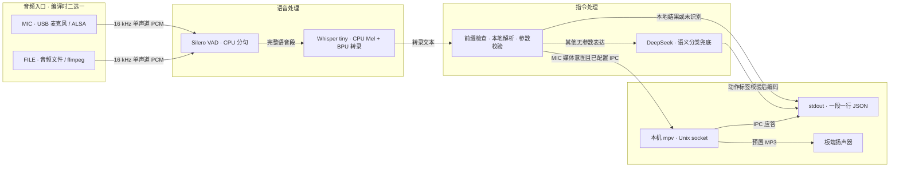
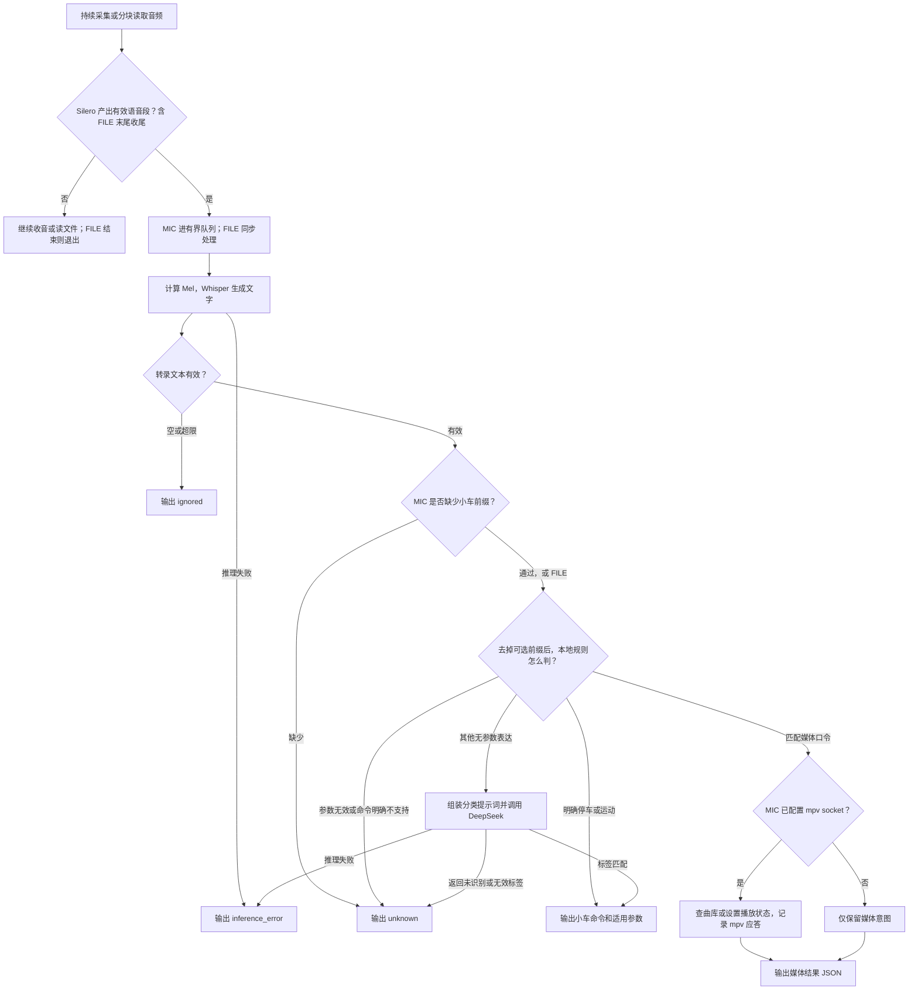
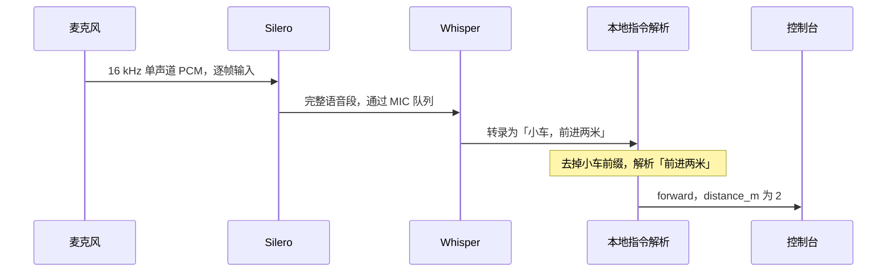

# S100 语音控制 Demo｜架构、流程与数据

这份文档描述仓库当前的业务。运行、配置和验证进度见 [README](../README.md)。

## 1. 从使用者看，这个 Demo 做什么

- **MIC 模式**持续听 USB 麦克风。说「小车，后退半米」，程序输出一条小车命令 JSON，由外部接收方决定怎么使用。说「小车，播放第二首」，如果配置了本地 mpv，程序就请求播放器播放预置的第二首 MP3，同时输出一条媒体结果 JSON。
- **FILE 模式**用已有录音验证识别和分类。一段录音可以有零条、一条或多条命令，程序按语音段顺序输出，读完退出。可以用它验证「播放第二首」的识别结果，实际播放入口只在 MIC 模式启用。
- **对外边界**是控制台 JSON 和本地 mpv IPC。运动命令到 JSON 为止，底盘、ROS 2 发布和动作执行由外部系统处理。

## 2. 架构图｜哪些模块互相依赖



架构图里的「本地结果」包含运动指令、媒体意图和停车。MIC 调用了 mpv 时，IPC 应答会先并入同一条媒体结果，再输出。标准输出承载结果，标准错误承载日志。[应用入口](../src/platform/linux/application.cpp) · [配置示例](../config.example.json)

## 3. 流程图｜收到一段语音后怎么分流



| 输入模式 | 从开始到结束 |
| --- | --- |
| FILE | ffmpeg 分块解码，Silero 检出一段就同步识别一段。按文件及语音段顺序输出，到文件末尾还会提交没有尾静音的最后一段。纯静音可以零输出。 |
| MIC | 采集线程持续读取、分句并入队，识别线程按顺序消费。队列满时丢弃新完成的语音段并记录日志。Ctrl+C 停止采集并等待在途处理。 |

「小车」目前由 **Whisper 转录后的文本规则**检查。「小车停车」通过检查后直接发 `stop`，仍经过 Silero、队列和 Whisper。实时音频上的关键词快路径属于待办。扬声器播放时 MIC 继续收音，当前没有回声消除。

## 4. 数据图｜拿一句话走一遍

以 MIC 听到「小车，前进两米」为例。图中文字是示意转录，JSON 只摘出业务字段，完整字段和状态见 [JSON 协议](../README.md#3-控制-json-协议)。



| 处理位置 | 输入 → 输出 | 在哪里改 |
| --- | --- | --- |
| 音频入口 | 麦克风采样或音频文件 → 16 kHz 单声道 PCM。FILE 解码后的数据按块进入分句。 | [Linux 音频输入](../src/platform/linux/audio.hpp) |
| Silero | 每次 512 个新采样点，带上历史上下文和循环状态 → 人声概率 → 根据尾静音及段长规则生成 PCM 语音段。 | [分句规则](../src/shared/speech_segmenter.hpp) · [audio、vad 配置](../config.example.json) |
| Whisper | 语音段 → CPU 计算 Mel → BPU Encoder 和 Decoder → Token 序列 → 中文或英文转录。原始转录保留在结果的 `transcript`。 | [Whisper 实现](../src/platform/s100/whisper.hpp) |
| 本地指令 | 原始转录 → 去掉前缀及首尾分隔符 → 动作和参数，或明确的 `unknown`。 | [动作、参数和媒体规则](../src/shared/command.hpp) |
| DeepSeek | 本地规则放行的转录文本 → 分类提示词 → 模型动作标签 → 本地校验和默认参数。默认直答由模板控制。 | [分类提示词](../src/shared/command.hpp) · [DeepSeek 接入](../src/platform/s100/deepseek.hpp) |
| 媒体播放 | `track_number` → 配置中的本地 MP3 路径 → mpv IPC 命令 → `playback.status`。 | [mpv 接入](../src/platform/linux/mpv_player.hpp) |
| 结果输出 | 动作或媒体意图 + 转录 + 来源 + 状态 + 计时 → 一行 JSON。 | [应用入口](../src/platform/linux/application.cpp) · [JSON 编码](../src/shared/command.hpp) |

### 几个结果对照

| 转录或输入 | 处理路径 | 结果摘要 |
| --- | --- | --- |
| 「小车，前进两米」 | 本地解析，米为单位 | `forward`，`parameters.distance_m=2` |
| 「小车，右转」 | 本地解析，用户未指定角度 | `right`，`parameters.angle_deg=90` |
| 「小车，前进两步」 | 显式参数使用未支持的单位 | `unknown`，无运动参数 |
| 「小车停车」 | Whisper 后的本地停车规则 | `stop`，无运动参数 |
| 「小车，往前走」 | DeepSeek 返回「前进」时 | `forward`，`parameters.distance_m=1` |
| 「小车，播放第二首」 | 匹配媒体口令；MIC 按配置发 IPC | `voice_media_intent`，`command=play`，`parameters.track_number=2` |
| 「小车，停止播放」 | 匹配媒体口令 | `voice_media_intent`，`command=stop_playback` |
| MIC 听到「前进」 | 缺少前缀 | `unknown` |
| FILE 输入全静音 | Silero 未提交语音段 | 零条结果 JSON |

下面两行分别摘取运动和媒体结果的业务字段。第二行以 FILE 输入为例。

```jsonl
{"message_type":"voice_control_result","transcript":"小车，前进两米","command":"forward","parameters":{"distance_m":2},"recognized":true,"status":"completed"}
{"message_type":"voice_media_intent","transcript":"小车，播放第二首","command":"play","parameters":{"track_number":2},"recognized":true,"status":"completed","playback":{"status":"intent_only"}}
```

媒体结果的外层 `completed` 表示识别到了意图。`playback.status=accepted` 表示 mpv 接受了命令，`error` 表示播放器拒绝、连接失败或超时等异常。FILE 和未配置播放器的 MIC 返回 `intent_only`。

## 5. 需求变了，先看哪里

| 需求变化 | 先确认业务约定 | 主要影响的位置 |
| --- | --- | --- |
| 增加小车动作或单位 | 口令、命令码、单位、默认值和无效参数行为 | 本地解析、DeepSeek 标签表、JSON 协议 |
| 更换 LLM | 哪些表达进入模型，允许返回哪些标签 | DeepSeek 接入、模型配置和输出校验。明确口令仍在本地分支 |
| 停车再提速或加入流式唤醒 | 是音频阶段检测还是转录后判断，是否需要抢占普通队列 | MIC 采集和分流入口。当前停车仍等待分句和转录 |
| 换麦克风、扬声器或曲库 | 采集设备、mpv 输出设备和曲目编号 | 运行配置、ALSA 输入和 mpv IPC |
| 以后接 ROS 2 或其他应用 | 接收方采用的消息类型、动作码和参数语义 | stdout JSON 契约及外部适配层 |

排查一条命令时，先看 `transcript` 是否正确，再看前缀和本地参数规则。 `timing_ms.deepseek_total` 为 `null` 时，该结果没有记录到 DeepSeek 总耗时，常见于本地分支。判断语音整体快慢时，还要单独看句尾等待，因为 `since_audio_end_ms` 从分句就绪后才开始计时。

### 已实现与待联调

FILE 和 MIC 均已交叉编译，早期 FILE 在板端验证过分句和模型链路。运动参数、媒体意图和 mpv IPC 分别做过文本或模拟验证。真实 USB 麦克风、实际扬声器和曲库仍待设备联调，流式停车和可切换 LLM 尚未接入。具体版本与实测结果见 [验证记录](../README.md#5-验证记录与剩余工作)。
