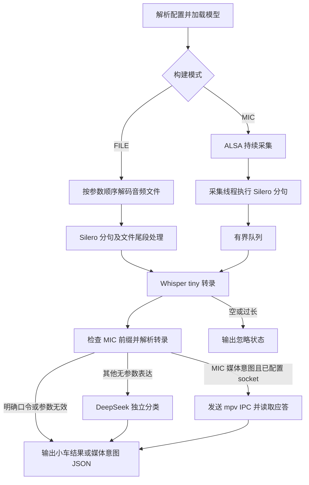

# 语音控制运行流程

FILE 和 MIC 是同一应用的两种构建模式。两者共享 Silero 分句、Whisper tiny 转录、本地口令规则、DeepSeek 分类和 JSON 输出。程序入口 `main.cpp` 调用 Linux 应用层，由应用层解析配置并加载对应模型与输入设备。[应用代码](../src/platform/linux/application.cpp)

| 模式 | 顺序与退出 |
| --- | --- |
| FILE | 同步逐段识别，保留文件与段落顺序。静音可产生零条结果。文件结束时处理残余语音，全部文件结束后退出。 |
| MIC | 采集线程将有效段放入有界队列，推理侧按队列顺序处理。队列满时丢弃新语音段并记录日志。Ctrl+C 停止持续采集，等待在途推理。 |

程序将结果逐行写到 stdout，应用诊断写到 stderr。字段、配置和命令见 [运行指南](../README.md)。历史 FILE 记录与当前构建的运行状态分别查阅，真实 USB 采集按需单独验证。
