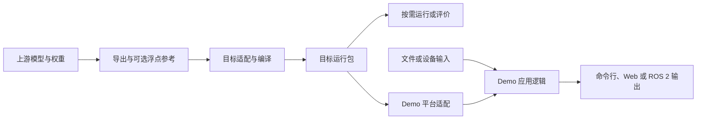

# 项目架构

仓库维护模型适配、目标运行环境和应用 Demo。一个模型可在多个目标上实验，一个 Demo 也可以组合多个模型。导出、编译、板端验证、评价和 Demo 开发均按本次任务选择，当前进度可以停在其中任一步。

## 当前目录

| 位置 | 职责 |
| --- | --- |
| [`mtk_models/`](../mtk_models/) · [`rdk_models/`](../rdk_models/) | 现有厂商模型适配，主要运行目标分别是 G720 和 S100。单模型维护配置、来源、主机和目标端实现、已有结果。 |
| [`configs/`](../configs/) · [`docker/`](../docker/) | 公开配置模板和实际使用的工具链环境。主机地址、SDK 路径、镜像或容器的本地选择由本地配置提供。 |
| [`demo/`](../demo/) | 应用工程，拥有自己的构建、配置、输入输出、示例和运行记录。 |
| [`tools/`](../tools/) · [`tests/`](../tests/) | 模型和环境脚本调用的 Python、Shell 工具及公共回归测试。部分工具由打包脚本随模型复制到板端。 |
| [`registry/`](../registry/) · [`reports/`](../reports/) | 现有模型检查索引、历史候选清单与部分平台结果导航。结果原件在各模型或 Demo。 |
| [`templates/`](../templates/) · [`docs/`](./) | 模型模板、开发资料和学习案例。使用模板时先检查平台专用假设。 |

## 模型与 Demo 如何连接



模型包在本地资源目录或 NAS 按目标组织。Demo 在本地配置中选择模型包，文档记录适用目标、模型版本或制品标识、张量或业务接口、运行库以及必要的 tokenizer、词表或标定文件。Demo 可以先用录制输入或参考后端开发，再接设备和目标运行包。原始数据、过程日志和精简结果分开存放，避免把一次运行的中间文件当作长期资源。

## 多平台扩展设计

以下是目标布局。现有命令继续按上面的当前目录查找，目录迁移按试点验证结果推进。

```text
models/<场景>/<任务>/<model_id>/
    model_card.md            模型身份、来源和通用输入输出约定
    targets/<target_id>/     目标配方、入口、专用代码和运行结果
platforms/<后端族>/          已确认可跨目标复用的编译、打包或运行适配
configs/platforms/           公开目标配置与本地覆盖约定
docker/                      实际使用的工具链环境，可由多个目标引用
demo/<应用>/                 应用逻辑、目标适配、示例和运行记录
tools/                       开发命令和跨平台公共模块
docs/                        导航、架构、开发和实验资料
```

- **模型身份**用 `model_id`，同一模型的跨目标共用内容须核对上游版本、模型结构、预后处理和数据协议。模型变体如相对深度与米制深度保留各自身份。
- **运行目标**用 `target_id`，配置明确设备或架构、操作系统、加速后端、编译目标和运行时。板卡名相同但系统或后端需要不同制品时分别标识。制品目录、远端运行目录和结果回传都要能区分目标。
- **后端族**按可复用的实现划分。厂商、板卡系列和工具链可以多对多。同一个目标可以使用 CPU 或硬件后端做不同实验，记录实际运行后端。
- **应用**按场景组织。平台代码处理 Runtime、外设或系统差异，应用流程和业务协议保持可复用。共用代码由已经出现的重复需求驱动。

## 索引和工具的迁移边界

`registry/models.yaml` 目前是 `tools/check_registry.py` 的输入，过渡期保留。采用统一模型目录后，优先让检查器从模型目录发现 `model_id`、已存在的目标和入口。若仍需手工维护跨目录别名或迁移映射，则只保留相应索引字段。模型来源以模型自身记录为准，实验指标以结果文件为准，候选目标放在路线图。旧注册状态按原记录解释，进度页描述已完成的具体步骤。

| 现有工具 | 迁移方向 |
| --- | --- |
| `storage.py`、`storage.sh` | 区分通用资源根目录和当前 MTK 路径解析。先解除目标与 `mtk_models/` 根路径的绑定，再考虑移动。 |
| `deploy.py`、`runtime.py`、`rdk_config.py`、`rdk_deploy.py` | 按后端归类配置、编译、打包、传输和运行逻辑。G720 与 S100 的默认值保留在现有目标适配或配置中。 |
| `evaluation.py`、`files.py`、`output_metrics.py` 等 | 保留为跨平台公共模块。对需要随独立模型包运行的模块，明确打包路径和依赖。 |
| Demo 专属工具 | 跟随应用，例如异步感知的 Orbbec ROS 2 发布器。 |

迁移试点先核对 Shell 入口、Python 导入、Docker 脚本和目标端打包清单。以 Whisper tiny 为例，先确认两边上游权重与输入输出语义，再列出各自的命令、配置、NAS 路径、板端包与回传目的地。每个批次按原目标复核调用关系和结果路径，确认无覆盖风险后再扩大移动范围。[迁移顺序](roadmap.md)
